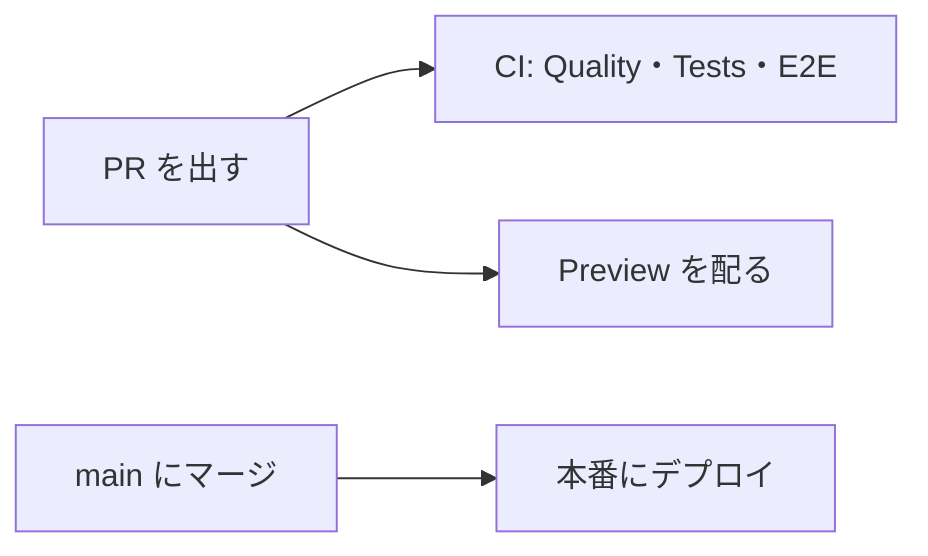

# ポイントスプリント

楽天のお買い物マラソンなどのイベントで、「あといくら買えるか、あと何店舗回るか」を計算するツールです。買い物の計画と注文を記録すると、獲得予定のポイントと、上限までの残額を出します。

個人で開発し、公開しているサイトです。ログインせずに使え、利用者の計画と記録はブラウザの IndexedDB に保存します。パスキーでログインすると、PC とスマホで同じデータを使えるように同期します。

サーバー（Cloudflare Workers）は、楽天の告知ページから集めた公式イベントのマスタを返し、商品の検索、問い合わせの送信、パスキーでのログインと暗号化したデータの同期を受け持ちます。ガイド記事は、ビルドのときにプリレンダーします。

本番: https://point-sprint.bmth.dev

## 必要なもの

- [mise](https://mise.jdx.dev/)。Node と pnpm の版は `package.json` の `devEngines.runtime` と `packageManager` に書き、mise が読みます（`mise.toml`）。`mise install` で入れます。CI とデプロイも `.github/actions/setup` から同じ版を入れます
- Node は `apps/web/scripts` などの `.ts` を、型を取り除いてそのまま実行します

## セットアップ

```sh
mise install
pnpm install
# pnpm test のブラウザテスト（web-browser）と E2E が使う Chromium を入れる
pnpm --filter web exec playwright install chromium
```

環境変数は、ルートの `.env.development` を dotenvx が読み込みます。公開してよい値は平文で、楽天 API のキーは暗号化してあります。キーを復号できなくても `pnpm dev` と `pnpm check:all` は動きます。そのときは警告が出て、商品の検索とガイド記事の商品一覧が出なくなります。

## よく使うコマンド

| コマンド         | すること                                                                                                                                                                    |
| ---------------- | --------------------------------------------------------------------------------------------------------------------------------------------------------------------------- |
| `pnpm dev`       | 開発サーバーを立てます。立てるたびに、ローカルの公式イベントのマスタ（D1）を `apps/web/migrations` から作り直します。ポートを変えるときは `pnpm dev --port <番号>` とします |
| `pnpm check:all` | `lint`、`fmt:check`、`type:check`、`spell:check`、`test` を順に実行します。PR を出す前に通します                                                                            |
| `pnpm test`      | Vitest で単体テストとブラウザテストを実行します                                                                                                                             |
| `pnpm test:e2e`  | E2E 用にビルドし（`pnpm build:e2e`）、Playwright で E2E テストを実行します                                                                                                  |
| `pnpm fmt`       | oxfmt で整形します                                                                                                                                                          |
| `pnpm build`     | ビルドし、プリレンダーしたページを確かめます。楽天のキーは `.env.development` のものを使います                                                                              |

### ワークフローの検査

`.github` のワークフローは、CI の Quality が [jactionlint](https://github.com/jdx/jactionlint) で確かめます。npm にはないので、`pnpm check:all` には入れていません。手元で確かめるときは、`uvx jactionlint` か mise（`mise x github:jdx/jactionlint -- jactionlint`）で、リポジトリのルートで実行します。`run:` のスクリプトは、shellcheck が入っていれば一緒に確かめます。

### E2E のポート

E2E は、ビルドしたものを `vite preview` でポート 4173 に配信し、楽天 API の代わりのサーバーをポート 4174 に立てます（`apps/web/playwright.config.ts`）。どちらもポートを固定していて、すでに使われていると起動しません。worktree を並べて E2E を走らせると、ポートを取り合います。使われていたら、止めずに空くのを待ちます。

## 構成

pnpm のワークスペースで、次のパッケージからなります。

- `apps/web`: アプリ本体です。TanStack Start で作り、Cloudflare Workers で動かします。画面の部品は Yamada UI v2 です
- `packages/domain`（`@workspaces/domain`）: ポイントの計算と、保存するデータのモデルです。React に依存しません
- `packages/ui`（`@workspaces/ui`）: Yamada UI の部品とテーマです

ファイルの置き場所、UI の部品の選び方、保存するデータの形を変えるときの決まりは [AGENTS.md](AGENTS.md) にあります。

`docs/` の直下には、いまの仕様と運用の決まりを置きます。用語、見た目、入力の検証、公式イベントの収集などです。`docs/superpowers/` には設計の経緯（仕様書、実装計画、技術検証）を、`docs/research/` には調査を置きます。

## デプロイとプレビュー



- **PR ごと**: CI（`.github/workflows/ci.yml`）が lint、整形、型、スペル、ワークフロー、依存の監査、ビルド、テスト、E2E を確かめます。Preview（`.github/workflows/preview.yml`）が PR のコードを Worker の Preview として配り、URL を PR にコメントします。URL は `https://pr-<PR番号>-point-sprint.jougennotuki67.workers.dev` です。PR の本文の「レビュー観点」の節にある `[ページ名](/path)` のリンクは、Preview の URL に書き換わります。Preview は本番とは別のデータベースを使います
- **main へのマージ**: Deploy（`.github/workflows/deploy.yml`）が本番の設定でビルドし、公式イベントのマスタのマイグレーションを流してから、Cloudflare Workers にデプロイします
- **毎日**: Event master（`.github/workflows/event-master.yml`）が、本番が 1 週間後に開催中の公式イベントを返すかを確かめます。返さなければ Issue を立てます（`docs/event-master.md`）
