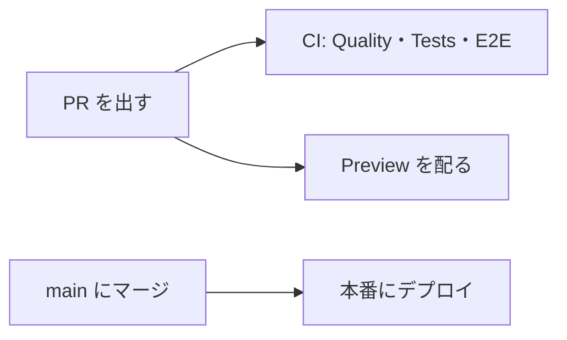

# ポイントスプリント

楽天のお買い物マラソンなどのイベントで、「あといくら買えるか、あと何店舗回るか」を計算するツールである。買い物の計画と注文を記録すると、獲得予定のポイントと、上限までの残額を出す。

個人で開発し、公開しているサイトである。ログインはなく、利用者の計画と記録はブラウザの IndexedDB に保存する。サーバー（Cloudflare Workers）は、楽天の告知ページから集めた公式イベントのマスタを返し、商品の検索と問い合わせの送信を受け持つ。ガイド記事は、ビルドのときにプリレンダーする。

本番: https://point-sprint.bmth.dev

## 必要なもの

- Node 26。CI とデプロイは `pnpm/setup` の `runtime: node@26` で動く。`apps/web/scripts` などの `.ts` は、Node が型を取り除いてそのまま実行する
- pnpm 12.9.1。`package.json` の `packageManager` に合わせる

## セットアップ

```sh
pnpm install
# pnpm test のブラウザテスト（web-browser）と E2E が使う Chromium を入れる
pnpm --filter web exec playwright install chromium
```

環境変数は、ルートの `.env.development` を dotenvx が読み込む。公開してよい値は平文で、楽天 API のキーは暗号化してある。キーを復号できなくても `pnpm dev` と `pnpm check:all` は動く。そのときは警告が出て、商品の検索とガイド記事の商品一覧が出なくなる。

## よく使うコマンド

| コマンド         | すること                                                                                                                                                     |
| ---------------- | ------------------------------------------------------------------------------------------------------------------------------------------------------------ |
| `pnpm dev`       | 開発サーバーを立てる。立てるたびに、ローカルの公式イベントのマスタ（D1）を `apps/web/migrations` から作り直す。ポートを変えるときは `pnpm dev --port <番号>` |
| `pnpm check:all` | `lint`、`fmt:check`、`type:check`、`spell:check`、`test` を順に実行する。PR を出す前に通す                                                                   |
| `pnpm test`      | Vitest で単体テストとブラウザテストを実行する                                                                                                                |
| `pnpm test:e2e`  | E2E 用にビルドし（`pnpm build:e2e`）、Playwright で E2E テストを実行する                                                                                     |
| `pnpm fmt`       | oxfmt で整形する                                                                                                                                             |
| `pnpm build`     | ビルドし、プリレンダーしたページを確かめる。楽天のキーは `.env.development` のものを使う                                                                     |

### E2E のポート

E2E は、ビルドしたものを `vite preview` でポート 4173 に配信し、楽天 API の代わりのサーバーをポート 4174 に立てる（`apps/web/playwright.config.ts`）。どちらもポートを固定していて、すでに使われていると起動しない。worktree を並べて E2E を走らせると、ポートを取り合う。使われていたら、止めずに空くのを待つ。

## 構成

pnpm のワークスペースで、次のパッケージからなる。

- `apps/web`: アプリ本体。TanStack Start で作り、Cloudflare Workers で動かす。画面の部品は Yamada UI v2
- `packages/domain`（`@workspaces/domain`）: ポイントの計算と、保存するデータのモデル。React に依存しない
- `packages/ui`（`@workspaces/ui`）: Yamada UI の部品とテーマ

ファイルの置き場所、UI の部品の選び方、保存するデータの形を変えるときの決まりは [AGENTS.md](AGENTS.md) にある。

`docs/` の直下には、いまの仕様と運用の決まりを置く。用語、見た目、入力の検証、公式イベントの収集などである。`docs/superpowers/` には設計の経緯（仕様書、実装計画、技術検証）を、`docs/research/` には調査を置く。

## デプロイとプレビュー



- **PR ごと**: CI（`.github/workflows/ci.yml`）が lint、整形、型、スペル、依存の監査、ビルド、テスト、E2E を確かめる。Preview（`.github/workflows/preview.yml`）が PR のコードを Worker の Preview として配り、URL を PR にコメントする。URL は `https://pr-<PR番号>-point-sprint.jougennotuki67.workers.dev` である。PR の本文の「レビュー観点」の節にある `[ページ名](/path)` のリンクは、Preview の URL に書き換わる。Preview は本番とは別のデータベースを使う
- **main へのマージ**: Deploy（`.github/workflows/deploy.yml`）が本番の設定でビルドし、公式イベントのマスタのマイグレーションを流してから、Cloudflare Workers にデプロイする
- **毎日**: Event master（`.github/workflows/event-master.yml`）が、本番が 1 週間後に開催中の公式イベントを返すかを確かめる。返さなければ Issue を立てる（`docs/event-master.md`）
